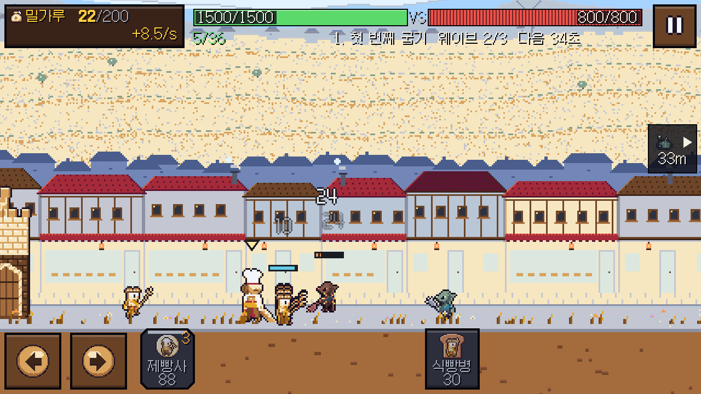

# 빵집 기사단: 곰팡이 디펜스

빵집 기사단을 이끌고 곰팡이 군단의 둥지를 부수는 가로 화면 도트 디펜스 게임입니다. 제빵사를 고용해 밀가루를 모으고, 병사를 출병시키며 영웅을 직접 움직입니다. 10개 라운드와 강화·진행 저장을 제공합니다.

## Windows에서 바로 실행

**[Windows v0.1.1 다운로드](https://github.com/soltyspring/defence_game/releases/tag/windows-v0.1.1-20261103)** · [ZIP 바로 받기](https://github.com/soltyspring/defence_game/releases/download/windows-v0.1.1-20261103/BakeryKnights-Windows-x64.zip)

1. 릴리스의 **`BakeryKnights-Windows-x64.zip`**을 내려받습니다. `Source code`는 실행 파일이 아닙니다.
2. ZIP을 폴더에 모두 압축 해제합니다.
3. **`BakeryKnights.exe`**를 더블클릭합니다. Godot 설치나 별도 빌드는 필요 없습니다.
4. **게임 시작** → 병사 출병 → 적 둥지 파괴 순서로 플레이합니다. 전투 중 **밀가루**로 제빵사를 고용하고 병사를 보냅니다. 라운드 보상 **골드**는 메인 화면의 **강화**에서 사용합니다.

Windows 64비트용입니다. 게임 데이터가 EXE 안에 들어 있어 `.pck`를 따로 찾을 필요가 없습니다. 함께 제공하는 `licenses` 폴더에는 엔진과 글꼴의 사용 고지가 있습니다. EXE는 코드 서명되지 않았습니다. 보안 경고가 뜨면 다운로드 출처와 릴리스의 SHA-256을 확인하세요.

## 조작

화면 버튼을 마우스로 눌러 플레이할 수 있습니다. 전투 중에는 아래 키도 지원합니다.

| 조작 | 키 / 마우스 |
| --- | --- |
| 영웅 이동 | `A` / `D` 또는 `←` / `→`, 화면 이동 버튼 누르고 있기 |
| 병사 출병 | `1`~`5` 또는 아래쪽 유닛 카드 클릭. 라운드에서 열린 카드만 사용 가능 |
| 제빵사 고용 | `E` 또는 제빵사 버튼 |
| 스킬 | `Q` / `W` / `R` 또는 스킬 버튼. 해금·기력·재사용 대기 조건 적용 |
| 일시정지 / 계속 | `P` / `Esc` 또는 일시정지 버튼 |
| 전장 둘러보기 | 전장 드래그 |

설정에서 효과음·음악 음량, 30/60 FPS, 피해 숫자, 화면 흔들림을 조절할 수 있습니다. 한국어 환경에서는 한국어, 그 외에는 영어를 자동으로 사용합니다.

## 저장과 빌드 상태

- 진행도·강화·설정은 자동으로 로컬에 저장합니다. Windows 경로는 `%APPDATA%\Godot\app_userdata\Lane Defence\`입니다. 폴더 이름에는 초기 개발명이 남아 있습니다.
- PC 변경 전에는 이 폴더를 복사해 보관하세요. 계정 연동·클라우드 동기화는 제공하지 않습니다.
- 광고·인앱 결제는 비활성 상태입니다.
- v0.1.1은 튜토리얼 지연·깜빡임, 콘텐츠 업데이트 뒤 진행 재잠금, 작은 화면 문구·수입 표시, 화면 하단 배경 띠, 어두운 카드 구분과 화면 밖 적 경고를 수정한 버전입니다. 영웅 표시·전장 배율을 다듬고 첫 보스의 강화 난이도를 조정했습니다.
- EXE·ZIP의 해시와 원본 커밋은 릴리스 및 ZIP 안의 `BUILD_INFO.json` / `SHA256SUMS.txt`에서 확인할 수 있습니다. 현재 확인한 실행 범위는 릴리스 설명에 적습니다.

수정본의 수락 156개, UI 3,414개, UI 통합 49개와 수정 회귀 검사 29개가 통과했습니다. 10개 라운드의 봇 검증과 저장 마이그레이션을 별도로 검사했습니다. 실제 폰·사람 플레이 검증은 포함하지 않습니다. 검사 조건과 캡처는 [v0.1.1 검토 기록](docs/qa/WINDOWS_POLISH_20261103.md)에 정리했습니다.



## 소스에서 실행

이 저장소는 **Godot 4.7.2 Standard / GDScript** 기준입니다. .NET 버전은 필요 없습니다.

```powershell
git clone https://github.com/soltyspring/defence_game.git
cd defence_game
& 'C:\Tools\Godot\Godot_v4.7.2-stable_win64.exe' --editor --path .
```

Godot에서 `project.godot`를 가져와 연 다음 리소스 가져오기가 끝나면 **F5(프로젝트 실행)**를 누릅니다. 엔진과 export templates는 저장소에 포함하지 않습니다.

## Windows EXE 직접 빌드

같은 버전의 Godot Windows export templates를 설치하세요. Godot의 **편집기 → 내보내기 템플릿 관리**에서 설치할 수 있습니다. **프로젝트 → 내보내기 → Windows Desktop → 프로젝트 내보내기**를 선택하면 됩니다. `export_presets.cfg`의 Windows 프리셋은 x86_64·데이터 내장 EXE로 설정되어 있습니다.

커밋된 소스만 사용해 재현하려면 PowerShell에서 실행합니다. 스크립트는 Git 스냅샷을 만들므로 다른 작업 중인 미커밋 게임 코드는 포함하지 않습니다.

```powershell
pwsh -NoProfile -File .\tools\build\build_windows.ps1 `
  -Godot 'C:\Tools\Godot\Godot_v4.7.2-stable_win64_console.exe'
```

결과는 `build/windows/<빌드시각>/BakeryKnights-Windows-x64.zip`입니다. 엔진 버전, 소스 SHA, 라이선스, EXE SHA-256과 메뉴·r01 자동 실행 확인을 함께 남깁니다. 빌드 로그와 개인 저장 데이터는 배포 ZIP에 포함하지 않습니다.

개발용 공유 PC에서는 Godot·빌드를 동시에 돌리지 않도록 `coordination/HEAVY_RUN.md`의 분리 실행 규칙을 따릅니다.

## 구조와 참고

- `src/`, `scenes/`: 전투·저장·UI·오디오 코드와 씬
- `data/`: 라운드·유닛·강화·한국어/영어 문구
- `assets/`: 도트 아틀라스·효과음·갈무리 글꼴
- `tests/`, `tools/qa/`: 검증 도구. [검증 안내](docs/verification/README.md)
- `docs/design/`, `docs/verification/`: 기획 결정·검증 결과·남은 문제

글꼴은 [갈무리](https://galmuri.quiple.dev/)를 사용하며 [SIL Open Font License 1.1](assets/fonts/OFL-Galmuri.txt)을 포함합니다. Godot 및 엔진의 외부 구성요소 사용 고지는 배포본 `licenses`에 있습니다. [Godot 라이선스](https://godotengine.org/license/), [Windows 내보내기 공식 안내](https://docs.godotengine.org/en/stable/tutorials/export/exporting_for_windows.html)를 참고하세요.
