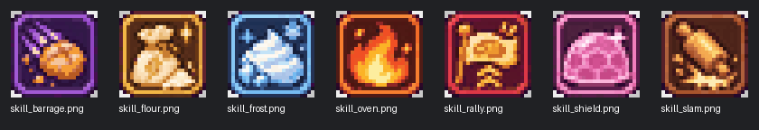

# 베이커리 나이츠: 캠페인·모바일 UI·스킬 아트 점검

대상: `bd8f34b`. 설계 검토이며 보상, 난이도, UI, 배포 에셋의 수치는 변경하지 않았다.

## 100라운드 경제

[라운드별 경제표](../design/balance/campaign100_economy.csv)와 라운드 JSON의 웨이브를 함께 봤다. 골드는 해당 라운드 진입 전까지 모든 이전 라운드를 3성으로 1회 클리어한다는 가정이다. 유료는 그 라운드까지 제시된 모든 팩을 합산한다. 게임 내 전투 자원과 영구 업그레이드에 쓰는 골드를 구분한다.

| 구간 | 직전 대비 적 HP 배율 | 무료 골드 | 누적 팩 골드 | 다시 볼 이유 |
| --- | ---: | ---: | ---: | --- |
| R23 | 1.99× | 10,892 | 6,000 | 프로스트 보스, 웨이브 총 9→17마리 |
| R42 | 1.91× | 28,482 | 24,000 | 둥지 코어와 공격 배율 상승 |
| R60 | 1.03× | 51,082 | 24,000 | 6웨이브·32마리와 둥지 코어 |
| R61 | 2.18× | 52,627 | 54,000 | 최대 배율 급등, 다만 4웨이브·10마리 |
| R79 | 1.01× | 88,188 | 98,000 | 오븐하트와 37마리; 배율만으로는 압박을 놓침 |
| R80 | 1.05× | 91,234 | 98,000 | 둥지 코어가 연속 보스 구간을 형성 |
| R96 | 1.51× | 139,232 | 162,000 | 둥지 코어, 다음 R97에서 HP 배율 30% 하락 |

초기 구현 `88b659e`의 로컬 봇 결과(난이도 1, 각 조건 3개 시드)는 무료 R60 3/3이나 중앙 561.6초, R61 3/3·103.2초, R79/R80/R96은 모두 0/3이었다. 동일한 세 라운드는 누적 팩 조건에서 각각 3/3이었다. 봇 스킬과 전투 코드가 이후 바뀌었으므로 현재 승률로 읽으면 안 된다.

가장 싼 영구 업그레이드를 먼저 사는 기존 모델로 보면 무료/누적 팩 경로의 레벨 구매 수는 R60 107/128, R61 109/148, R79 137/185, R96 166/220회다. 동일 덱 기준이며 실제 플레이어의 구매 순서나 별 획득률과는 다르다. 현재 결과에 따른 무과금 우선 재플레이는 **R23 → R42 → R60–61 → R79–80 → R96/R100**. 첫 시도에는 직전 저장 상태에서 이어가고, 남은 골드·주력 레벨·실패 시점·클리어 시간을 기록한다. 고정 타워를 매 웨이브 구매하는 일반 TD 모델 대신 이 게임의 봇과 업그레이드 모델을 사용한다.

현재 `bd8f34b`에서 기존 검증 스크립트에 무료 경로를 추가해 60Hz로 실행했다. 기본 편성, 봇 난이도 1, 29/47/83 시드로 표본 8개 라운드를 각각 독립 실행했다. **24회 모두 패배**했으며 같은 라운드에서 세 시드의 종료 시간이 같았다. 이 결과는 해당 정책과 편성의 재현 가능한 경고다. 사람도 이길 수 없거나 결제가 필수라는 뜻은 아니며, 30Hz의 이전 결과와 조건이 달라 원인을 특정할 수 없다. 유료 경로와 전체 캠페인 재실행은 이 표에 포함하지 않았다.

| 라운드 | 승리 | 패배까지 걸린 시간 |
| --- | ---: | ---: |
| R23 | 0/3 | 314.8초 |
| R42 | 0/3 | 476.0초 |
| R60 | 0/3 | 376.6초 |
| R61 | 0/3 | 322.1초 |
| R79 | 0/3 | 221.8초 |
| R80 | 0/3 | 377.0초 |
| R96 | 0/3 | 194.4초 |
| R100 | 0/3 | 391.6초 |

## 모바일 UI

Godot 기준 화면은 640×360, `canvas_items / expand / integer`다. 격리된 Godot 4.7.2에서 UI 3,419개와 골드 상점 미리보기 17개 검사가 통과했다. 이전 UI 통합 검사도 49개 통과했다.

레이아웃 계산을 옮긴 hud_layout_mirror.py에서 좌우 34px·하단 16px, 5카드·3스킬 기준 640×360은 48px 세로 배열, 800×360은 48px 가로 배열, 480×270은 34px 축소 배열이었다. 이 수치는 레이아웃 계산이며 실제 터치 결과는 아니다.

## 스킬 아이콘 7종

| ID | 그림 | 보이는 RGB 색 수 |
| --- | --- | ---: |
| slam | 밀대 | 23 |
| rally | 깃발 | 24 |
| barrage | 보라색 궤적의 포탄 | 24 |
| flour | 밀가루 자루 | 24 |
| shield | 분홍 방어막 | 22 |
| frost | 파란 얼음 | 24 |
| oven | 불꽃 | 24 |

모두 PNG RGBA 24×24, 투명 픽셀 14–16개. 보이는 픽셀은 24색 이하, 투명 픽셀의 숨은 RGB까지 포함하는 스킬 검사기의 RGBA 기준은 26개 이하다. 이 차이 때문에 `--max-colors 24`는 6개를 오탐으로 표시하고, `--expect-size 24x24 --require-alpha --max-colors 26`은 7개를 통과했다. 가독성 검토에서는 출전 준비 640×360 캡처에서 7개를 구분할 수 있었다. 전투 HUD 캡처에서는 방어막·얼음·불꽃이 확인됐다. 쿨다운 숫자가 뜨면 방어막 그림 위에 숫자가 올라오므로 색만으로 구분하지 않는 실제 기기 검토가 유용하다.

공통 출처는 [ChatGPT 생성 원본 시트](../art/gpt_sources/skillicon/skill_icons.png), 결과는 `assets/art/skills/skill_<id>.png`, 변환은 `python tools/art/gpt_import.py icons`다. 마젠타 배경을 제거하고 24×24로 축소한 뒤 24색 팔레트를 적용한다. 원본은 [보관 브랜치](https://github.com/soltyspring/defence_game/tree/codex/archive/skill-icon-art-20261114)에서도 복구할 수 있다. 별도 제3자 에셋 팩이나 라이선스는 원본 기록에서 확인되지 않았다. 기술 검사 통과는 배포 권리 확인이나 실기 승인과 별개다.
`gpt_import.py icons`를 격리 폴더에서 다시 실행한 결과 7개 모두 픽셀이 완전히 일치했다. 개별 파일과 원본 해시는 [아이콘 매니페스트](2026-11-14-skill-icon-manifest.json)에 기록했다.

