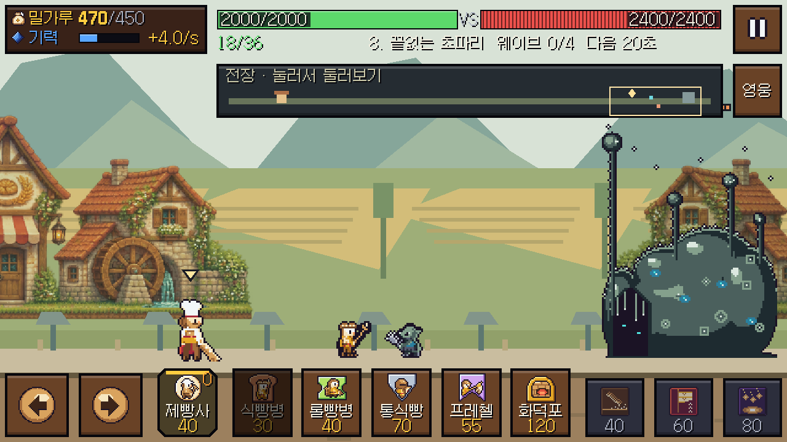
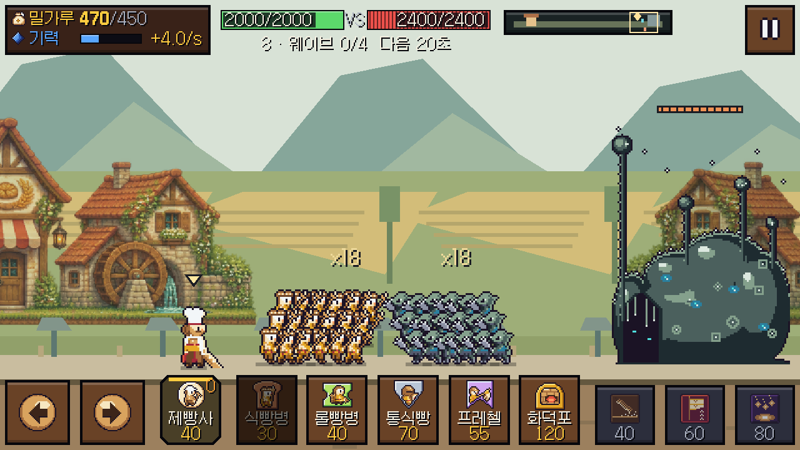
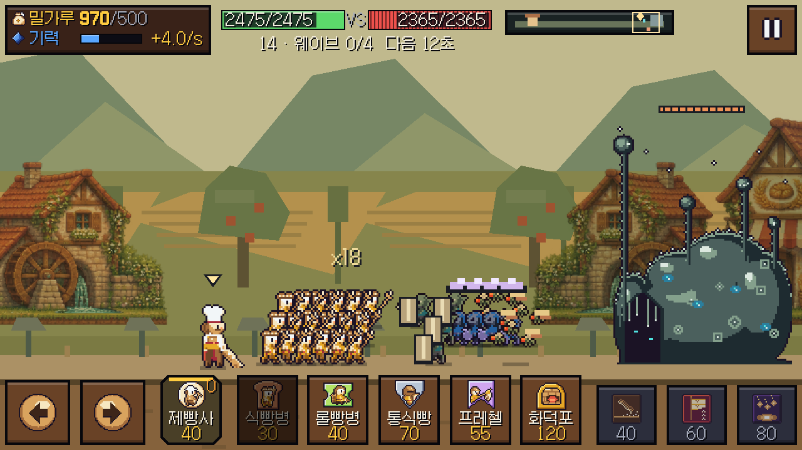
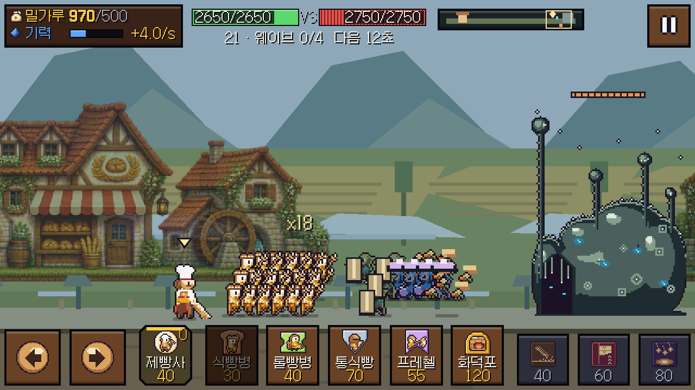
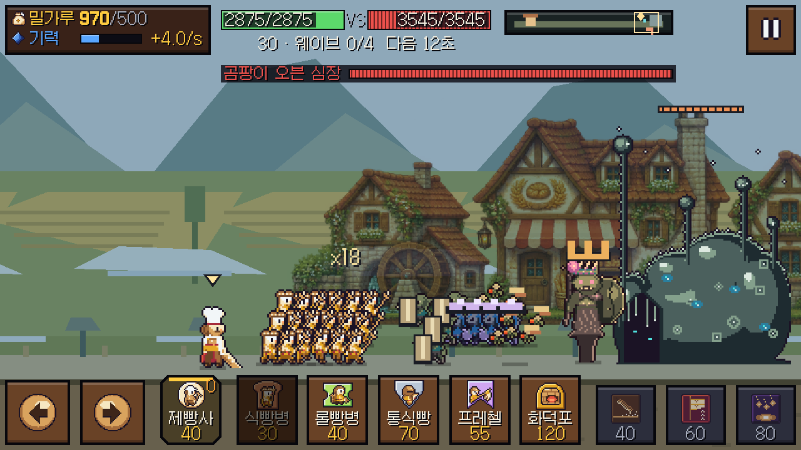
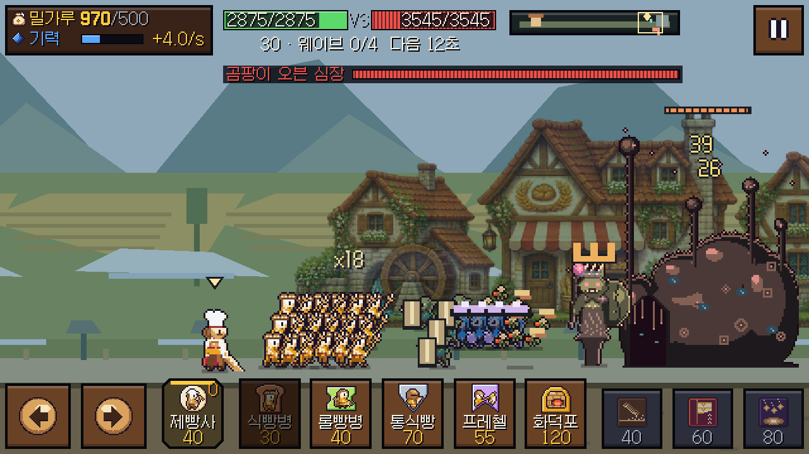
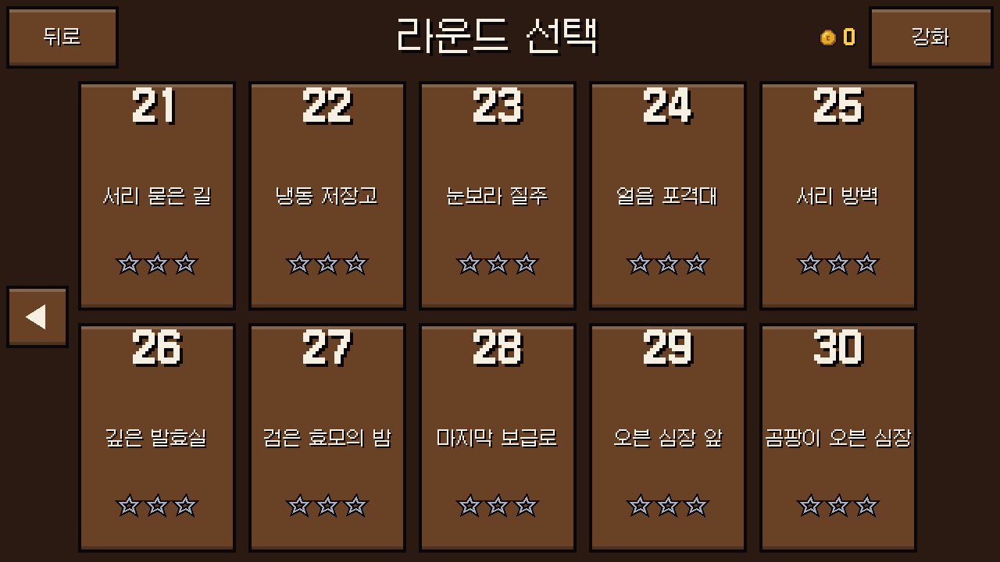

# 30라운드·전투 가독성 개선 — 2026-11-05

## 변경과 근거

사용자 요청: 기지 피해 숫자의 끊김, 같은 캐릭터의 겹침, 과도한 UI와 큰 미니맵을 고치고 리소스 비용을 고려해 30라운드까지 구성한다.

- 기지 피해는 0.24초 단위로 합산한다. 연타 시 표시 나이를 0으로 돌리지 않으며, 0.8초 동안 감속 상승 후 페이드한다. 생성 시 확보한 숫자 위치는 수명이 끝날 때까지 유지한다. 렌더 보간과 기기 픽셀 단위 정렬을 적용했다.
- 밀집 병력은 3열로 표시하고 오프셋을 부드럽게 따라간다. 이동·사거리·타격·충돌·경제 수치는 그대로다. 세 열 모두 지면 위에 있어 하단 카드에 발이 가리지 않는다. 6명 이상 같은 종류가 모이면 xN을 하나만 표시한다. 투사체는 목표의 표시 위치로 향한다.
- 미니맵: 1280×720의 논리 640×360 화면에서 410×40의 별도 줄을 139×40으로 줄이고, 실제 그림은 높이 20 안에 넣었다. 클릭/터치 영역은 40 이상이다. HP·웨이브·미니맵은 상단 한 줄에 모았고, 영웅 복귀 버튼은 정찰 중에만 나타난다. 둥지의 중복 가장자리 안내도 제거했다.
- r01~r10 JSON 및 기존 유닛 정의는 이전 소스와 내용이 동일함을 비교했다. 11~30에는 네 조합의 방패·돌격·포격·혼성 파동과 HP별 둥지 지원군을 배치했다. 15 제분장 파수꾼, 20 과수원 균사왕, 25 서리 방벽, 30 곰팡이 오븐 심장이 처음 웨이브부터 등장한다.
- 기존 애니메이션/텍스처/효과음을 재사용한다. 새 적 3종과 보스 4종은 색·방패·포자 갓·왕관으로 역할을 구분한다. 공격음은 같은 음원을 역할별 피치로 변주한다. 과수원 나무·사과와 서리 길 표식은 기존 배경 메시 안에 한 번만 굽는다. **추가 PNG/WAV 파일은 0개**다.
- 후반 강화 4단계는 11/16/21/26에 열린다. 이전 강화 가격·레벨은 보존한다. 열리지 않은 단계를 눌러도 골드가 차감되지 않는다. r10을 끝낸 기존 저장은 r11을 열고 음량 등 설정을 유지한다.

## 참고 화면의 관찰과 해석

[팔라독 플레이 화면(MobyGames 보존 이미지)](https://cdn.mobygames.com/screenshots/12242565-paladog-browser-stage-type-1.png)에서는 상단 자원/진행과 하단 출병·스킬을 전장 가장자리에 모으는 구성을 확인했다. 하단 UI도 큰 편이므로 이 게임의 공간 문제에 그대로 복사하지 않았다.

[냥코 대전쟁 공식 소개](https://battlecats.club/en/series/battlecats/)의 [전투 이미지](https://battlecats.club/en/series/battlecats/img/game_img02.png)에서는 단순한 전장 배경, 선명한 외곽선과 다른 높이/형상의 실루엣, 하단 카드 구성을 관찰했다. 두 게임의 내부 겹침/충돌 알고리즘은 공개 화면으로 알 수 없다. **3열 시각 대형은 우리 게임의 해결안**이며 이들 게임의 내부 구현이라고 주장하지 않는다. 참고 이미지는 분석에만 사용했고 배포에 넣지 않았다.

## 검증

모든 엔진 실행은 직렬화했고 APPDATA를 임시 경로로 분리했다. 보이는 검사는 DISPLAY2에서 실제 위치를 확인했다. 시스템 백신·드라이버 설정은 수정하지 않았다.

| 확인 | 결과 |
|---|---|
| 캠페인/저장/강화 게이트/숫자 곡선/대형 경계 | 390 PASS, FAIL 0 |
| 실제 렌더/미니맵 입력/복귀/연타 숫자 위치 | 414 PASS, FAIL 0; 1280×720 |
| 기존 UI | 3415 PASS, FAIL 0 |
| 실제 UI/전투 입력 통합 | 49 PASS, FAIL 0 |
| 효과음·음악 %와 저장 | 29 PASS, FAIL 0 |
| 저장 복원·기존 수정 회귀 | 29 PASS, FAIL 0 |
| 전체 acceptance | 156 PASS, FAIL 0, NOT_TESTED 2 |
| 11~30 최대 해금 강화 | 20라운드×2정책×3시드=120회 승리, 보스 등장 확인 |
| 실제 보상으로 강화하는 경로 | 2정책 모두 11→30 통과, 각 20회 승리, 외부 골드 주입 없음 |

보상 경로의 시작값은 기존 r10 LOW+2R 표의 강화(근접/원거리5, 탱크/속공/영웅/수입/기력4, 공성3, 제빵사4, 기지5)와 잔여 24골드다. 각 라운드 직전에 살 수 있는 가장 싼 강화부터 구매하고 승리/첫 클리어/별 보상을 실제 Save에 기록했다. 마지막 잔여와 단계는 [economy.json](campaign-20261105/economy.json)에 있다. 봇에는 0~3초 출발 지연과 의사결정 지연을 넣었으며 경과 시간을 올바르게 전달했다. 최대 강화 검사의 동일 결과 시드는 독립적인 인간 숙련도 증거가 아니다. 이 검사는 도달 가능성과 비용 막힘 검증이며 재미·인간 난이도나 모든 전략의 승리를 보장하지 않는다.

초기 회귀에서 영어 라운드명 두 개가 좁은 타일에 잘렸다. `Root Orchard`, `Deep Cellar`로 다듬은 뒤 같은 전체 acceptance를 재실행해 FAIL 0을 확인했다. 이전 10라운드 전용 테스트의 종료 표식도 실제 라운드 수를 사용하도록 갱신했다.

## 같은 장면의 비용

r08, 아군18+적18+영웅1, 동일 위치·해상도·줌1.5, 시뮬레이션 정지 후 표시만 갱신하는 비교다. 시작/폰트 준비 180프레임을 제외했다. RTX 2070 SUPER의 짧은 데스크톱 표본이며 실기기 발열·배터리·동적 최대 부하 결과는 아니다.

| 항목 | v0.1.3 | 변경 후 |
|---|---:|---:|
| 드로우콜 | 137 | 110 |
| 텍스처 메모리(bytes) | 16,269,093 | 16,443,855 |
| process 중앙값(ms) | 1.763 | 2.937 |
| process p95(ms) | 2.185 | 2.937 |

표시 대형의 CPU 비용과 글리프 캐시의 소폭 증가를 숨기지 않는다. 새 PNG/WAV는 없으며 드로우콜은 감소했다. 추가 보스가 있는 r30 강제 밀집 화면은 약19.41MB의 텍스처와132 드로우콜이었다. 실시간 일반 전투의 전체 성능으로 확대 해석하지 않는다.

## 화면 증거

아래는 겹침 비교를 위해 병력을 강제로 같은 위치에 놓고 출병 골드/대기시간을 조작한 **검증용 장면**이다. 실제 플레이 보상 경로와 분리했다.

변경 전:

변경 후:

전체 기계 판정은 [acceptance.json](campaign-20261105/acceptance.json), [render-checks.json](campaign-20261105/render-checks.json), [balance.json](campaign-20261105/balance.json)을 참고한다. Android 실기기와 인간 청감/플레이 검증은 별도다. Windows 패키지 출처·해시는 배포 ZIP의 BUILD_INFO.json과 SHA256SUMS.txt에서 확인한다.

## EXE 확인 중 추가 수정

첫 Windows 패키지의 실제 마우스 조작에서 미니맵 클릭으로 먼 전장을 보고 영웅 버튼으로 복귀했다. 일시정지 → 설정에서 효과음을 100%에서 50%로 끌었고, 격리 저장 파일에도 sfx=0.5가 기록됐다. r14·r21은 EXE로 직접 시작해 오류 없이 종료했다. 외부 .gd QA 스크립트를 배포 EXE에 주입하는 방식은 사용하지 않고 일반 실행 경로로 확인했다. 위 414개 표시는 Godot 엔진의 소스 렌더 검사다.

실제 EXE 화면에서 보스 왕관이 투명 프레임 여백에 매달려 떠 보이는 문제를 찾아 수정했다. 기존 아틀라스의 불투명 픽셀과 발 피벗을 측정해 포자 갓은18, 전쟁군주 계열 왕관은44, 대군주 계열 왕관은55 높이에 붙였다. 런타임 이미지 읽기나 새 텍스처는 추가하지 않았다. 수정 후 같은 390개 기능 검사와 414개 렌더·입력 검사를 다시 통과했고 위 보스/포격수 이미지를 갱신했다.

## 공개 Windows 배포 검증

[Windows v0.1.4](https://github.com/soltyspring/defence_game/releases/tag/windows-v0.1.4-20261105), 게임 소스 `1bc5112edfe26dcf91ff0b60453ecf4db21febf8`에서 새로 import/export했다. 수정된 최종 EXE에서도 일반 실행으로 r30을 열고 실제 마우스로 작은 미니맵을 눌러 왕관이 머리에 붙은 보스를 확인했다. DISPLAY2, 1280×720, 정상 종료 exit 0. 30초 표본의 FPS는60, sim 최대0.45ms였으며 장시간/실기기 성능 검증을 뜻하지 않는다.

로그인 없이 공개 ZIP을 다시 내려받아 업로드 파일과 SHA-256 일치, ZIP CRC 정상, 내장 EXE 해시와 라이선스 포함을 확인했다. [기계 검증 기록](campaign-20261105/windows-release.json).

- ZIP: 40,959,957 bytes, SHA-256 `03e5deb43efc2bf39701f4b92c27889be0b1c6fb413fb27db6618e3f9239844d`
- EXE: SHA-256 `361d5075ea1e363e995dafb981c4072646f5c23b6d26028a5a2b0751bcb4f58f`

이후의 README/배포 기록 정리는 게임 바이너리를 바꾸지 않는다.
