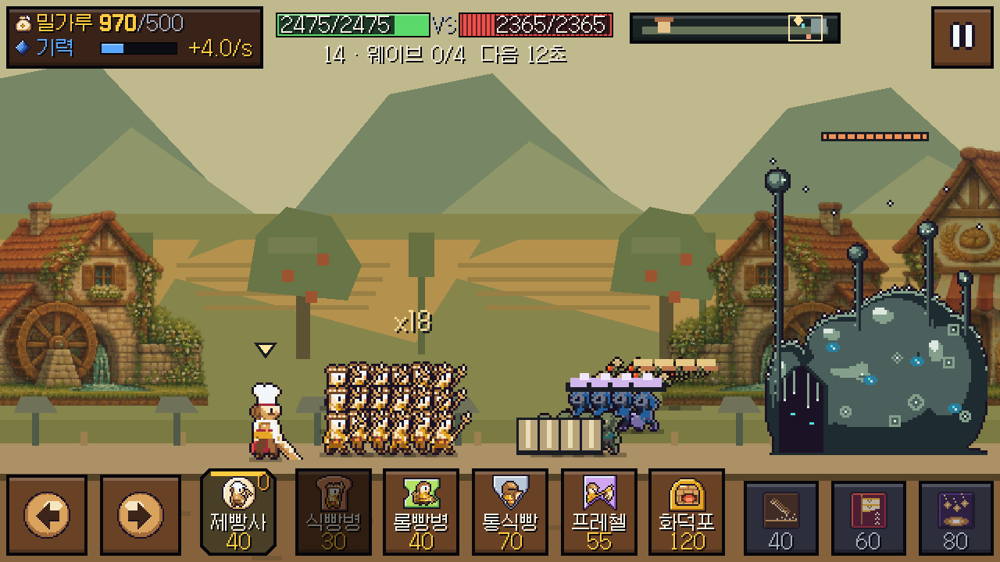

# 입력·병력 대형·QA 진단 수정 (2026-11-07)

## 재현 및 수정

사용자는 다른 사람이 내려받은 게임에서 해상도에 따라 버튼이 눌리지 않는다고 보고했다. 그 PC의 실제 설정은 전달받지 못했다. 여기서는 창 크기를 바꾸는 경로에서 버튼이 화면 밖으로 나가는 문제를 재현했다.

Godot의 Viewport.size_changed만으로 창 크기를 추적했다. 정수 확대 배율이 유지되면 논리 뷰포트 크기가 그대로여서 이 신호가 오지 않는 경우가 있다. 관찰값은 실제 창 640×360인데 UI 논리 영역은800×450, 그리고 1366×768인데640×360과 여백이 남는 경우다. 작은 창에서는 우측/하단 버튼 중심이 실제 창 밖에 남았다. App이 실제 Window.size 변경도 매 프레임 비교하고 새 크기로 정수 배율·논리 영역을 갱신하도록 고쳤다. 네이티브 백엔드의 이전 크기를 읽는 순서 문제도 피해 처리한다.

버튼을 누른 채 크기를 바꾸면 기존 포인터 캡처도 취소한다. GUI 영역 밖으로 간 release와 취소된 터치, 버튼이 안 눌린 상태로 돌아온 마우스 움직임도 처리해 다음 클릭이 막히지 않게 했다. 이 처리는 게임 전투 수치와 별개다.

검사는 논리 좌표로 직접 탭하던 기존 테스트와 달리 실제 표시 위치를 창의 픽셀 좌표로 투영하고 Viewport.push_input(..., false)로 전달한다. 중심이 네이티브 창 안에 있는지도 검사한다. [Godot Viewport 입력 좌표 정의](https://docs.godotengine.org/en/stable/classes/class_viewport.html#class-viewport-method-push-input).

동일한 새 검사를 기존 v0.1.4 게임 코드와 수정본에 실행했다. 기존116개 중8 FAIL, 수정116개 중0 FAIL. 640×360, 800×450, 1280×720, 1366×768, 1600×900, 1280×800, 창 크기 변경 도중의 눌림, content_scale_factor 1/1.25/1.5, 실제 최대화/전체화면을 포함했다. 배율 검사는 엔진 배율 시뮬레이션이며 Windows 설정을 바꾼 검사는 아니다. 전부 DISPLAY2와 격리 APPDATA에서 실행했다. 특정 다른 PC의 드라이버/입력 장치까지 검증했다고 주장하지 않는다.

## 대형

0.08초마다 근처 유닛의 UID 순위를 다시 계산하던 방식은 주변 병력 하나가 들어오거나 사라질 때 다른 유닛까지 행을 바꾸게 했다. 이제 각 유닛은 처음 배정받은 3개 행 중 하나를 생존 기간 동안 유지한다. 기존 병력의 자리를 우선하고 새 유닛은 빈 가로 칸으로 들어간다. 기존 무리가 합쳐질 때는 0.3초 지속되는 충돌에만 반응하며, 가로 보정 속도는30 world px/s로 제한한다. 전사한 유닛 때문에 남은 병력이 앞으로/위아래로 압축되지 않는다. 시뮬레이션의 이동·사거리·충돌·전투 판정은 바꾸지 않았다.

18명을 같은 위치에 놓았을 때 표시 위치18개를 유지했다. 600프레임 동안 이웃 경계를 왕복하고 병력10명을 교체한 시나리오에서 생존자의 y 이동거리0, 행 변경0. 발이 하단 카드 영역으로 내려가지 않음, 가로 보정 속도와 퇴장 슬롯 정리도 확인했다.

## QA 로그 원인

- 서비스 테스트 오류: SceneTree._initialize 중 노드의 _ready를 직접 호출해 트리에 들어가기 전에 절대 경로를 조회했다. 검사를 deferred로 시작하고 엔진의 정상 ready 수명주기를 사용한다. 503 PASS, 엔진 오류0.
- 실제 유닛 누수: Unit.w_target 두 개가 서로를 강하게 참조했다. 약한 참조로 바꿔 전투 객체가 사라지면 두 타깃도 해제된다. 서로 타깃을 가진 두 유닛을 버린 뒤 WeakRef가 모두 null인지 확인했다.
- UI 테스트의 노드3개 누수: Node.new로 만든 가짜 버스/저장 객체를 트리에 넣거나 free하지 않았다. 테스트 패널의 자식으로 소유해 함께 해제한다.
- 앵커 경고: 가로/세로 끝 앵커가 다른 설정/강화 패널에 size를 직접 지정했다. 크기를 명시적으로 배치하는 패널의 앵커를 좌상단에 맞췄다.
- 종료 시 오디오 리소스 경고: 실제 App 종료와 달리 QA는 재생 중인 WAV/Ogg를 즉시 종료했다. 실제 게임과 같은 Audio.prepare_quit와 오디오 스레드 대기 경로를 사용한다. 수락/통합 검사에서 ObjectDB·리소스 경고/오류0을 확인했다.
- UI 테스트의 `zz_new_engine_key` 경고는 없는 문구 키를 의도적으로 주입하는 기존 검사다. 원문 키를 사용자에게 보이지 않고 진단하는 예상 경고1건이므로 숨기지 않았다. 실제 게임에서 해당 키를 보내지 않는다.

## 결과

전체 수락156 PASS/0 FAIL(미검증2), 캠페인390 PASS, UI3415 PASS, 실제 UI 통합49 PASS, 음량29 PASS, 서비스503 PASS, 대형 안정성6 PASS, 픽셀 입력116 PASS, 실제 렌더/정찰/숫자 위치414 PASS. [판정 요약](fix-20261107/checks.json), [수락 보고](fix-20261107/acceptance.json), [렌더 보고](fix-20261107/render.json).

Android 실기기와 타인의 PC에 대한 직접 검사는 포함하지 않는다. 기존 QA의 오디오 이벤트 훅 항목은 미검증 표시이며 음량 입력/저장은 별도 통합 검사에서 통과했다. 백신·OS 드라이버나 시스템 배율 설정은 수정하지 않았다.
