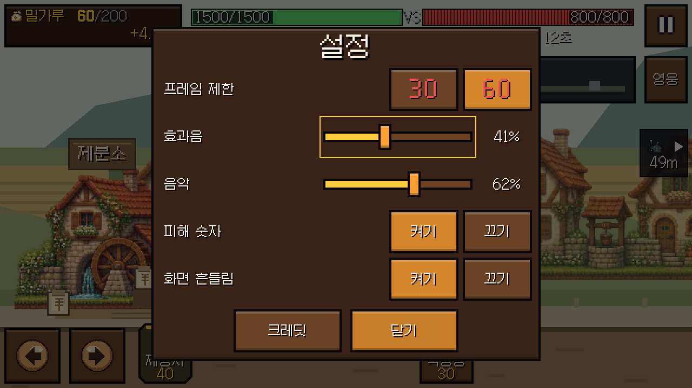

# Windows v0.1.3 — 음량 퍼센트 조절

효과음과 음악의 켜기/끄기를 각각 **0~100%, 1% 단위** 슬라이더로 바꿨다.
메인 → 설정, 전투 → 일시정지 → 설정 모두 같은 컨트롤을 사용한다.
기존 저장값(예: 음악 0.8)은 그대로 80%로 표시하며 새 저장 형식을 만들지 않는다.

- 마우스/터치 탭·드래그로 조절하고 현재 퍼센트를 표시한다. 0%는 음소거다.
- 선택한 슬라이더에서 좌우 방향키는 1%, Home/End는 0/100%다.
- 드래그 중 `Events.cmd_preview_volume`으로 실제 Audio의 해당 채널만 즉시 반영한다.
  재생 미리보기마다 저장 파일을 쓰거나 클릭 효과음을 반복하지 않는다.
- 놓기·숨기기·포커스 상실 때 `cmd_set_setting`으로 마지막 값을 저장한다.
  이때만 기존 저장/설정 경로를 사용한다. 다른 채널의 음량은 유지한다.
- 퍼센트는 기존 음량 설정값이다. Audio의 기존 perceptual taper·master limiter는 유지한다.

## 확인

`tests/integration/test_volume_settings.gd`는 mock 없이 실제 App/Events/Audio/Save와
Viewport 터치·드래그·키 입력으로 29개 검사를 수행했다. 세 실행 모두 **29 PASS / 0 FAIL**이다:
headless, DISPLAY2 640×360, DISPLAY2 1280×720.

실제 bus의 음량과 mute, 드래그 동안 파일 불변, 놓은 뒤 저장, 디스크에서 정확한 값 재로드,
다른 채널 불변, 양 끝 clamp, 키보드 1%, focus loss, 다시 열기, credits 화면 숨김,
전투 일시정지를 유지한 음량 조절을 확인했다. private APPDATA만 사용했다.

기존 UI 검사 **3,415 PASS / 0 FAIL**. 기존 UI 검사 종료 시 남던 ObjectDB 경고 3개는 그대로다.
새 통합 검사와 실제 화면 실행은 정상 종료했다. 전투·라운드·수입·강화와 WAV는 변경하지 않았다.
백신·드라이버·서비스 설정도 변경하지 않았다.

Windows v0.1.3의 소스 SHA와 EXE/ZIP SHA-256은 릴리스 및 BUILD_INFO.json에 기록한다.

실제 Windows 마우스의 빠른 드래그에서 최종 좌표가 release에만 들어오는 경우를 재현했다.
터치/마우스 모두 놓는 위치를 반영한 뒤 저장하게 수정하고, 이동 이벤트 없는 드래그와
마우스+터치 에뮬레이션의 중복 저장 방지까지 같은 입력 조건으로 재검증했다.

## 배포 확인

게임 소스 `5d14487191598ef3eab2c16e5c2be0df325129d2`로 만든 v0.1.3 EXE에서도 같은 빠른
마우스 드래그가 정상 반영됐다. 효과음을 36%로 끈 뒤 방향키로 37%로 바꾸고 음악을 62%로
조절했다. 설정을 닫고 다시 열었을 때 37%/62%였으며, 격리된 실제 EXE 저장 파일의 값도
각각 0.37/0.62였다. [디스크 확인](volume-settings/exe-volume-settings.json).

[Windows v0.1.3](https://github.com/soltyspring/defence_game/releases/tag/windows-v0.1.3-20261105)을
공개했고, 인증 없이 ZIP을 다시 내려받아 ZIP/EXE SHA-256·CRC·라이선스 파일이 일치하는 것을
확인했다. [공개 다운로드 검증](volume-settings/public-verification.json).
