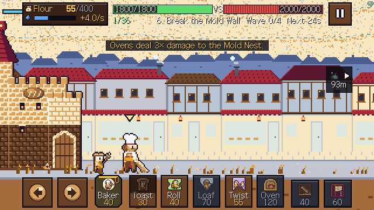
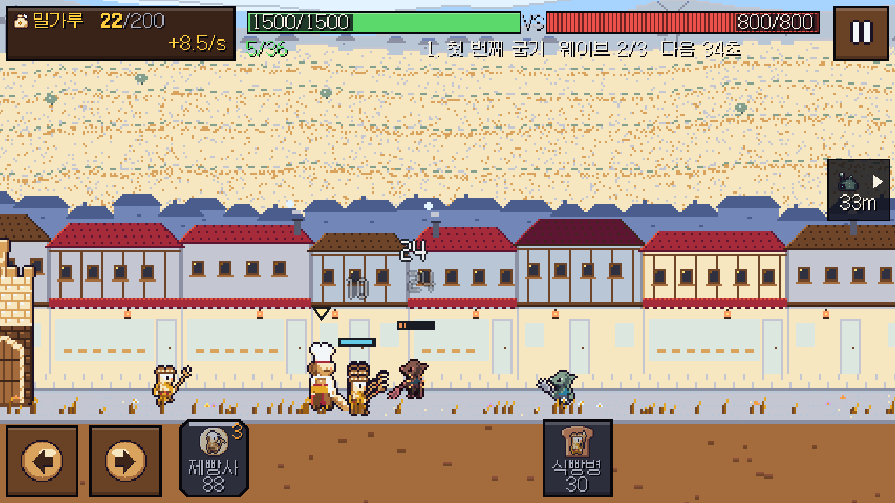

# Windows v0.1.1 수정·검증 기록 — 2026-11-03

사용자 요청에 따라 Codex가 직접 게임을 수정했다. Kiro 작업자를 다시 실행하지 않았다. 기존 미검증 UI 배치와 저장 수정은 백업 후 검토·보완해 채택했고, 오디오 측정용 훅·아트 생성기 등 이번에 검증하지 않은 다른 작업은 포함하지 않았다.

## 수정한 동작

| 문제 | 수정 | 같은 조건에서 확인한 내용 |
| --- | --- | --- |
| 첫 출병 안내 지연, 이미 한 행동 안내 깜빡임 | 첫 출병은 즉시 안내, 완료한 단계는 표시 없이 기록. 이동 안내 제한 8초 | 새 회귀 검사와 실제 엔진 UI 통합 통과 |
| 효모병 경고가 등장 전에 끝남 | 살아 있는 효모병이 등장할 때 경고 | 등장 전 부재·등장 후 표시 검사 |
| 함성의 설명에 없는 공격 속도 증가 | 피해·이동 버프만 유지, 영웅 오라는 유지 | 공격 쿨다운 회귀 검사와 전 라운드 봇 재측정 |
| 콘텐츠 삽입·이동·개명 뒤 진행 재잠금 | 기존에 열렸던 라운드 ID 보존, 아직 안 연 구간은 잠금 유지. 구매한 강화는 다시 잠그지 않음 | 25개 마이그레이션 사례 중 24 PASS / 0 FAIL / 1 INFO. 음수·범위 밖·별 0개·일시 제거 ID 추가 검사 |
| 깊이 중첩된 저장 확장 데이터에서 마이그레이션 복제 오류 | 변경하는 정제된 컨테이너만 복제하고 알 수 없는 확장 데이터는 보존. 개명 추론이 이전 스냅샷을 직접 수정하지 않게 함 | 600단 중첩 보존 및 저장 중 실패 시 강화·지급 내역·골드·이전 스냅샷·중복 방지 키 복원 검사 |
| UI와 엔진의 라운드 잠금 불일치 | 메뉴·선택·강화·다음 라운드가 Save의 판정을 공유 | 실제 선택 화면과 저장 API의 일치 검사 |
| 작은 화면에서 수입·웨이브 잘림 | 수입을 둘째 줄로 이동, 웨이브·남은 시간을 제목보다 우선. 카드 폭·버튼 간격 확보 | 640×360/400/480, 800×360, 좌우 노치 34, 목표 40/48 배치 검사. 영문 640×360 실제 캡처 |
| 하단 배경 조각 띠 | 앞 장식의 지면 기준 정렬, 지면을 화면 아래까지 연장 | 실제 1280×720 렌더 확인 |
| 화면 밖 적 경고가 작동하지 않음 | 실제 카메라 범위·가장 가까운 적·둥지 위치를 HUD에 전달 | 실제 화면에서 방향·거리 표시 확인 |
| 영웅·보스가 배경에 묻힘 | 영웅 머리 위 포인터, 중장갑 적·보스 명도 조정, 정수 픽셀을 유지하는 전장 확대 | 고정 장면 이미지·픽셀 측정과 실제 화면 별도 확인 |
| 어두운 카드 구별 실패 | 아이콘 불투명도 0.45 → 0.70. 비활성 판·비용 색은 유지 | r08/r10 전 카드 비활성 U1 10쌍 중 실패 0, 최소 모양 거리 13.4 ≥ 12 |
| 결과 시간과 시간 별의 경계 모순 | 표시 시간을 올림해 150.4초를 2:31로 표시 | 기존 결과 화면·별 조건 검사 통과 |
| 저장 실패 후 다음 라운드 유도 | 오류 문구 유지, 저장되지 않은 결과의 다음 버튼 숨김 | UI/수락 검사 통과 |

## 실행 검사

Godot 실제 버전: `4.7.2.stable.official.ed1daf0bf`. 모든 실행은 전용 APPDATA와 직렬 실행 잠금을 사용했다. 실제 사용자 저장은 수정하지 않았다.

| 검사 | 결과 |
| --- | --- |
| 수락 검사 | 156 PASS / 0 FAIL / 2 NOT_TESTED |
| UI 검사 | 3,414 PASS / 0 FAIL (배치 3,000조합 포함) |
| UI 통합, r01 실제 엔진 | 49 PASS / 0 FAIL |
| 수정 회귀 검사 | 29 PASS / 0 FAIL |
| 영문 640×360, r06, 노치 34/34 실제 렌더 통합 | 44 PASS / 0 FAIL |
| 밸런스 검사 실패 종료 코드 | 정상 조건 exit 0, 의도적으로 실패시킨 1-seed 상한 조건 exit 1 |

수락 검사의 미검증 2개는 AUD-03(실제 소리 청취·설정/일시정지 종합)과 PLAT-03(실물 Android 기기)이다. 테스트 종료 때 ObjectDB/resource 정리 경고가 있어 검사 숫자만으로 메모리 무결성을 주장하지 않는다. 배포 EXE의 메뉴·전투 실행 로그는 별도로 확인한다.

재잠금 묶음은 기존 `f606801` 테스트 기준에 수정한 `save.gd`를 덮어씌운 격리 복사본에서 실행했다. 이 묶음의 결과를 순정 `f606801` 통과로 해석하면 안 된다. 최종 저장 코드의 추가 경계 조건은 회귀 검사에 포함했다.

## 첫 보스와 진행 곡선

시드 101–110, 수정된 봇 시간 간격, casual 정책. LOW는 첫 클리어 보상으로 산 강화, LOW+2R은 이전 라운드 두 번의 재도전 보상을 더 쓴 강화다. 라운드별 예산은 `docs/design/balance/upgrade_budgets.json`을 사용했다.

| 조건 | 승리 | 승리 시간 중앙값 |
| --- | --- | --- |
| r01–r04 LOW | 각 10/10 | 91.4 / 115.8 / 148.6 / 127.2초 |
| r05 강화 없음 | 0/10 | — |
| r05 LOW | 8/10 | 291.5초 |
| r05 LOW+2R | 10/10 | 283.8초 |
| r06–r09 LOW | 각 10/10 | 134.3 / 224.7 / 207.2 / 181.2초 |
| r10 LOW | 10/10 | 440.3초 |
| r10 LOW+2R | 10/10 | 322.3초 |

r05 LOW 승리 시 기지 잔량 중앙값 0.41. 기존 D28 하한과 D33 상한을 모두 통과했다. 시간 별·강화 가격·보상은 바꾸지 않았다. 봇은 강화 관문의 존재를 검사하며, 사람이 정확히 2–3번 시도한다거나 재미있다는 증거는 아니다.

## 화면 증거의 범위

고정 아트 검사 7장(전투 5장)은 기존 `capture_art_baseline.gd`의 **카메라 배율 1** 조건을 유지했다. 창 포커스 변경 때 수동 시뮬레이션만 멈추는 검사 결함을 고쳐 프리패스와 캡처의 시각이 맞게 했다. 이 프레임을 새 전장 확대의 실물 폰 크기 검증으로 사용하지 않는다.

영문 노치 화면과 배포 EXE 캡처는 게임의 기본 확대를 사용한다. 최소 터치 변 44px·간격 8px, 겹침 0·안전 영역 밖 0은 고정 세트에서 확인했다. 실제 기기에서의 편안함·가독성·색각 접근성과 사람의 첫 3분 이해도는 별도 확인이 필요하다.

수정 뒤 고정 전투 5장의 영웅 명도 차이는 최소 23.2, 최종 보스는 19.6(기준 15 이상)이다. 명도 차이 15 미만인 유닛 비율은 모든 장면 0%, 아군·적 최근접 색 차이의 최소는 일반 19.5 / deutan 모사 15.9로 기존 기준 15 / 12를 넘었다. 색각 모사는 실제 사용자의 판별 시험을 대체하지 않는다.

세부 수치와 시드별 결과: [검증 데이터](windows-polish/evidence.json).

## 재현

- `tests/acceptance/test_polish.gd`: 튜토리얼·버프·저장·UI 경계 조건.
- `tests/acceptance/acceptance.gd`, `tests/ui/test_ui.gd`, `tests/integration/test_ui_integration.gd`: 기존 전체 검사.
- `tests/acceptance/probe_balance.gd -- --rounds=r05 --seeds=10 --budgets=none,low,low2r --policies=casual --rows --d28`: 첫 보스 상·하한.
- `tools/build/build_windows.ps1`: 커밋에서 독립 Windows 패키지·라이선스·해시 생성 및 EXE 메뉴/r01 실행 확인.

실행 파일의 정확한 소스 커밋·해시는 릴리스 ZIP의 `BUILD_INFO.json`과 `SHA256SUMS.txt`에 있다. [Windows v0.1.1 릴리스](https://github.com/soltyspring/defence_game/releases/tag/windows-v0.1.1-20261103).

## 배포 확인

- 소스 커밋: `45a4d25d4ad3b9e0d7da9bdc2398d338c70180c0`. 이 뒤 검증 문서만 갱신했다.
- EXE: 111,823,696 bytes, SHA-256 `4180178df2af00a2ca502f7147eac22e95972e40d1a05a8af9f6506323fceac5`.
- ZIP: 40,499,308 bytes, SHA-256 `df614813b5c1ac480e9f151f0141a4efc17edb86833554fcdef205dfd89d5203`.
- 커밋에서 추출한 최종 소스로 위 156/3414/49/29 검사를 다시 통과했다. TP-13b 중첩 데이터 검사에서 기존 `Max recursion reached` 오류도 사라졌다.
- 배포 EXE를 소스·외부 PCK 없는 폴더에서 메뉴와 r01로 실행했다. 헤드리스와 실제 1280×720 메뉴/45초 전투 모두 exit 0, 런타임 오류 0, 오디오 자산 누락 0. 보이는 창은 DISPLAY2에 놓였음을 확인했다.
- GitHub 공개 링크를 로그인 없이 다시 내려받아 ZIP/EXE 해시·ZIP CRC·라이선스를 확인했다. [배포 검증 데이터](windows-polish/release.json).

42초 EXE 프레임은 60 FPS, 드로우콜 100을 기록했다. 짧은 데스크톱 장면 관측값으로, 최저 사양·발열·장시간 성능을 보장하지 않는다.

