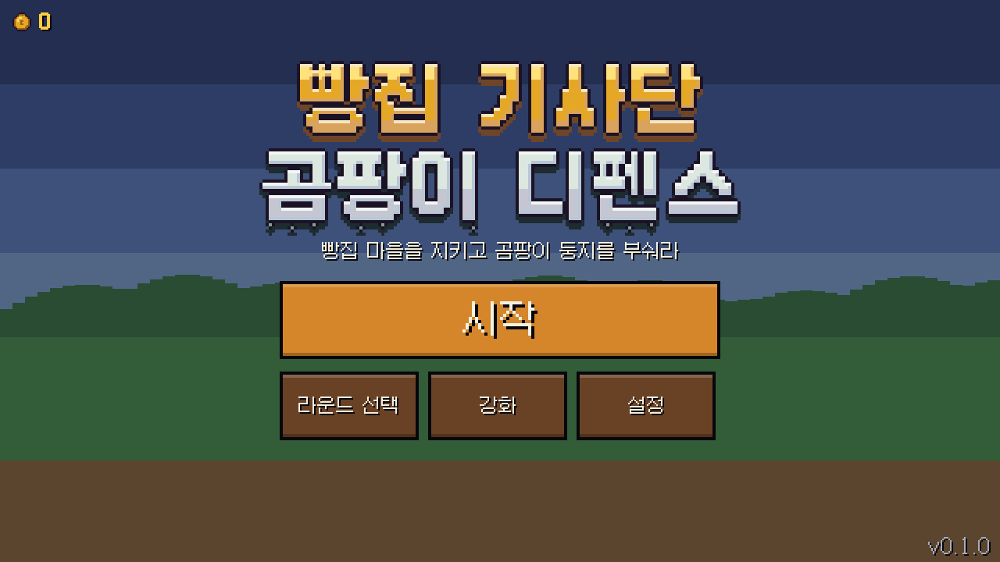
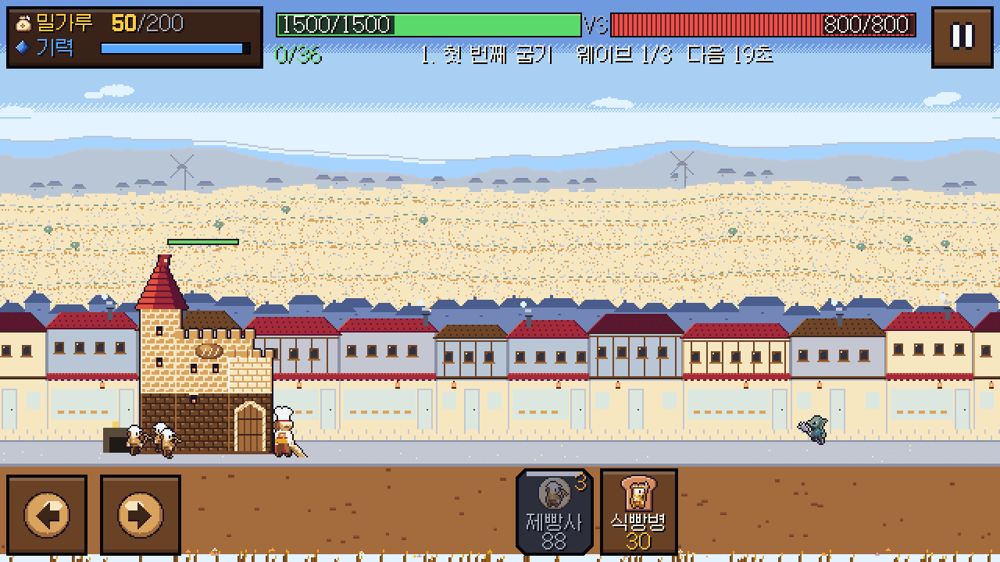

# Windows 미리보기 검토 — 2026-11-03

이번 작업은 기존 게임의 Windows 실행·배포와 사용 안내를 정리했다. 게임 로직·기획 데이터·아트는 수정하지 않았다. 기존 담당 Claude의 사용량이 677.01/50이고 97% 중단 표식이 남아 있어, 담당 수정은 배정하지 않았다. 로그인 확인 없이 표식을 해제하지 않았다.

## 배포 기준

- 게임 소스: `373b3316a6dd90d7226d33663cb71ef1d0900934`의 Git 스냅샷.
- 엔진: 실제 `--version` 출력 `4.7.2.stable.official.ed1daf0bf`.
- Windows x86_64, PCK 내장 EXE, 미서명 개발 미리보기.
- EXE 111,762,416 bytes. SHA-256: `7f938384c7d009505eeaa7aae669ed3600c71a452807bd8bda446cb61485436d`.
- 로컬 빌드: `build/windows/preview-20261103c/`. 사용자 저장은 모든 실행에서 별도 APPDATA로 격리했다.
- 공유 작업트리의 미커밋 UI·오디오·저장 수정은 빌드에 포함하지 않았다.
- 내보내기 로그의 저장 파일 340개 중 data JSON 21개. tools/docs/tests/coordination 경로 누출 0개.
- 정확한 엔진 바이너리에서 추출한 MIT 라이선스·외부 구성요소 고지와 갈무리 OFL을 ZIP에 포함했다.

## 실제 확인

| 확인 | 결과 | 증거 |
| --- | --- | --- |
| EXE 메뉴 시작·정상 종료 | PASS, exit 0, boot ok, 런타임 오류 0 | exe-menu.log |
| EXE r01 자동 진행·정상 종료 | PASS, exit 0, boot ok, 오디오 누락 0 | exe-battle.log |
| 기존 수락 검사 | PASS 156 / FAIL 0 / NOT_TESTED 2 | qa/acceptance_report.json |
| 기존 UI 검사 | PASS 3414 / FAIL 0 | qa-ui.log |
| 기존 UI 통합 검사 | PASS 48 / FAIL 1 | qa-integration.log |
| 실제 EXE 그래픽 출력 | 메뉴·r01 1280×720, exit 0, DISPLAY2 배치 확인 | visual-menu/, visual-battle/, 아래 캡처 |
| r01 22초 프레임 | 아군·적 포함 유닛 5개, 60 FPS, draw calls 80 | visual-battle/godot_20261103_080947.log |

FPS는 짧은 데스크톱 장면 관측값이다. 전체 게임·최저 사양·장시간 성능으로 일반화하지 않는다. 수락/UI/통합 검사 종료 때 ObjectDB/resource cleanup 경고가 있었으며, 실제 배포 EXE의 메뉴·전투 로그에는 같은 경고가 없었다. Android·실제 폰·사람 플레이 검증은 수행하지 않았다.

## 가장 강한 미해결 문제와 후속 담당

| 문제 | 확인 수준 / 영향 | 담당과 동일 조건 재검증 |
| --- | --- | --- |
| r01 튜토리얼 기대 시점 불일치 | 이번 통합 검사도 `real tutorial hint shown in r01 (: '')`로 실패. 테스트는 약 3.4초에 기대하나 코드는 영웅 미이동 시 4초부터 표시. 기존 CR-007 / TEXT_REVIEW_02와 일치 | 02가 첫 안내 의도를 01 결정과 맞추고, 04가 실제 시점·이미 출병한 경우의 깜빡임까지 검증. 같은 통합 검사를 다시 통과시킬 것 |
| 화면 하단의 픽셀 띠 | 이번 EXE 1280×720 캡처에서 HUD 바로 아래 끝부분에 잘린 배경 조각처럼 보이는 띠가 관찰됨. 원인은 미확정 | 02/04가 같은 해상도 실제 렌더에서 확인하고 땅·HUD 경계 및 카메라 클리핑을 점검 |
| 흐린 유닛 카드 구분 | 기존 07 QA-B021 재개 기록: r08·r10에서 카드 전부가 어두워질 때 2쌍 실패. 이번에 재판정하지 않음 | 06/04 수정 후 같은 all-dimmed 장면으로 07 U1 재검증 |
| 영문 웨이브 줄 | 기존 TEXT_REVIEW_02: 640 노치 r06 6개 배치에서 2.6px 초과. 이번에 재판정하지 않음 | 04 수정 후 같은 640×360/400/480·양측 노치·48px 대상 조건으로 재검증 |
| 콘텐츠 변경 후 라운드 재잠금 | 기존 10의 25건 기준 및 02 미검증 사본 존재. 현재 main에는 수정이 없음 | 02 수정 후 10의 같은 재잠금 묶음과 07 save/faults 통과 필요 |
| 목표 난이도·첫 3분 경험 | Q5 B(2~3회 시도 뒤 강화해서 클리어)는 확정됐으나 충족을 입증하지 못함. 봇 승률은 사람의 재미 증거가 아님 | 01/02 밸런스 수정과 07 검증. 실제 플레이 확인도 필요 |

## 재현

Windows 패키징: `pwsh -NoProfile -File tools/build/build_windows.ps1 -Godot <Godot console exe>`.
이 PC의 무거운 실행은 기존 `coordination/heavy_run_detached.ps1`로 직렬 실행했다. 패키지와 스크린샷은 GitHub Release/이 문서에 제공하며, 게임 전체 다듬기가 완료되었다고 판정하지 않는다.
